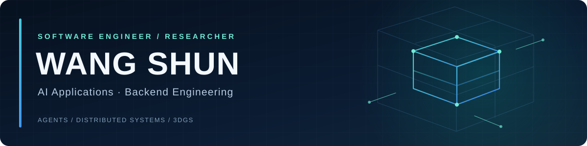

**English** · [简体中文](README.zh-CN.md)

### AI Application Development / General Backend Development

Focused on LLM tool calling, RAG, Agent orchestration, code generation, as well as backend service governance and engineering delivery.

## About Me

- Master's student at **Shanghai Ocean University**, working on real-time 3D reconstruction of UAV imagery based on **3D Gaussian Splatting (3DGS)**.
- Interested in **AI Agents, LLM application engineering, Java backend, and distributed systems**.
- Use Claude Code, Codex, GPT, Gemini, and DeepSeek to assist with requirement breakdown, solution design, implementation, code review, and debugging — with quality controlled through manual review, testing, and CI/CD.
- For the full experience and online project demos, visit [my resume website](https://wangshun.work).

## Featured Projects

| AI & Agent Applications | Backend & Infrastructure |
| :--- | :--- |
| **[AI Coder](https://github.com/wangshun-china/ai-code)**    Full-stack platform for generating frontend applications from natural language, with multiple Agents covering planning, scaffolding, UI coding, review, fixing, preview, and deployment.    `Spring AI Alibaba Graph` · `LangChain4j` · `Tool Calling` · `RAG` · `Redis` · `Dubbo` · `Vue 3` · `Docker`    [Source](https://github.com/wangshun-china/ai-code) · **[Live Demo](https://ai-coder.wangshun.work)** | **[Lumina-RPC](https://github.com/wangshun-china/lumina-rpc)**    Self-built lightweight RPC framework covering protocol codec, service registry and discovery, dynamic proxy, load balancing, fault tolerance, tracing, and a visual control plane.    `Java` · `Netty` · `ByteBuddy` · `SPI` · `SSE` · `Vue Flow` · `ECharts`    [Source](https://github.com/wangshun-china/lumina-rpc) · **[Live Demo](https://rpc.wangshun.work)** |
| **[Agent Quest](https://github.com/wangshun-china/agent-quest)**    Interactive levels showcasing Agent Harness capabilities: boundaries, tool calling, planning, memory, observability, and evaluation.    `TypeScript` · `Agent Harness` · `Tool Calling` · `Observability`    [Source](https://github.com/wangshun-china/agent-quest) · **[Live Demo](https://agent.wangshun.work)** | **API Relay Platform**    Self-hosted and maintained LLM API relay service, providing a unified interface, call management, and usage analytics across different model providers.    `Model API aggregation` · `Channel management` · `Usage analytics` · `Docker` · `Nginx` · `HTTPS`    **[Live Service](https://api.wangshun.work)** |
| **[AutoGuard AI](https://github.com/xixi-box/AutoGuard-AI-Reviewer)**    GitHub App for intelligent code review — pulls PR diffs via Webhook, calls LLMs to generate structured review comments, and posts them back.    `Python` · `FastAPI` · `GitHub App` · `Webhook` · `DeepSeek` · `JWT` · `HMAC`    [Source](https://github.com/xixi-box/AutoGuard-AI-Reviewer) | **More Projects**    Explore detailed project write-ups, engineering notes, and interactive demos on my portfolio.    **[Explore Portfolio](https://wangshun.work)** · [GitHub Organization](https://github.com/wangshun-china) |

> **Demo availability:** Some online demos run on a local WSL instance and are exposed to the public internet via FRP. When offline, the source code and project descriptions on my website are still available.

## Open Source

I contribute fixes and improvements to open-source projects alongside building my own tools. See the review history, discussions, and merged changes directly on GitHub.

**[Merged Pull Requests](https://github.com/search?q=is%3Apr+author%3Axixi-box+is%3Amerged&type=pullrequests)** · [All Pull Requests](https://github.com/search?q=is%3Apr+author%3Axixi-box&type=pullrequests)

## Engineering & Delivery

- [Resume website](https://github.com/wangshun-china/interview-web): a Vue 3 resume site with project showcase and a lightweight ops console, live at [wangshun.work](https://wangshun.work).
- [Deployment templates](https://github.com/xixi-box/template): reusable solutions for GitHub Actions, Docker Compose, Self-hosted Runner, Nginx, and FRP.
- Some code and core projects are mainly maintained in the [wangshun-china](https://github.com/wangshun-china) organization.

## Tech Stack

&nbsp;
&nbsp;
&nbsp;
&nbsp;
&nbsp;
&nbsp;
&nbsp;
&nbsp;
&nbsp;

**AI Applications:** `Spring AI Alibaba` · `LangChain4j / LangGraph4j` · `ReAct Agent` · `Tool Calling` · `RAG` · `Prompt Engineering` · `Structured Output` · `LLM API Integration`

**Backend & Middleware:** `Java 21` · `Python` · `Spring Boot 3` · `FastAPI` · `Dubbo 3` · `Nacos` · `Netty` · `MySQL` · `Redis / Redisson` · `Caffeine` · `SSE`

**Frontend & Visualization:** `TypeScript` · `Vue 3` · `Vite` · `Element Plus` · `Tailwind CSS` · `Vue Flow` · `ECharts`

**DevOps & Deployment:** `Git` · `Docker / Docker Compose` · `GitHub Actions` · `CI/CD` · `Nginx` · `Linux` · `Alibaba Cloud ECS / ACR` · `Self-hosted Runner` · `FRP`

---

[Website](https://wangshun.work) · [GitHub Organization](https://github.com/wangshun-china) · [Contact Me](mailto:2606209307@qq.com)

