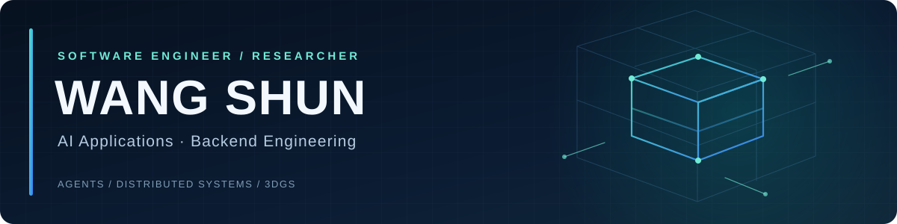
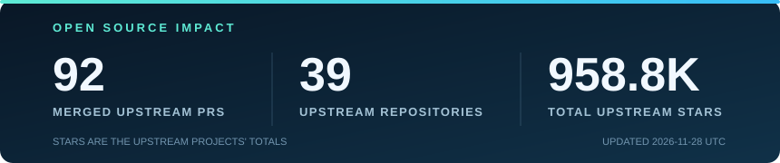

[English](README.md) · **简体中文**

### AI 应用开发 / 通用后端开发

关注大模型工具调用、RAG、Agent 编排、代码生成，以及后端服务治理与工程化交付。

## 关于我

- **上海海洋大学**硕士研究生，方向为基于 **3DGS** 的无人机影像实时三维建模。
- 关注 **AI Agent、LLM 应用工程、Java 后端与分布式系统**。
- 使用 Claude Code、Codex、GPT、Gemini、DeepSeek 辅助需求拆解、方案设计、实现、Review 与 Debug，并通过人工审查、测试和 CI/CD 控制交付质量。
- 完整经历与在线项目演示请访问 [个人简历网站](https://wangshun.work)。

## 精选项目

| AI 与 Agent 应用 | 后端与基础设施 |
| :--- | :--- |
| **[AI Coder](https://github.com/wangshun-china/ai-code)**    面向自然语言生成前端应用的全栈平台，通过多 Agent 完成规划、脚手架生成、UI 编码、审查、修复、预览与部署闭环。    `Spring AI Alibaba Graph` · `LangChain4j` · `Tool Calling` · `RAG` · `Redis` · `Dubbo` · `Vue 3` · `Docker`    [源码](https://github.com/wangshun-china/ai-code) · **[在线体验](https://ai-coder.wangshun.work)** | **[Lumina-RPC](https://github.com/wangshun-china/lumina-rpc)**    自研轻量 RPC 框架，覆盖协议编解码、服务注册发现、动态代理、负载均衡、容错保护、链路追踪及可视化控制面。    `Java` · `Netty` · `ByteBuddy` · `SPI` · `SSE` · `Vue Flow` · `ECharts`    [源码](https://github.com/wangshun-china/lumina-rpc) · **[在线演示](https://rpc.wangshun.work)** |
| **[Agent Quest](https://github.com/wangshun-china/agent-quest)**    用交互式关卡展示 Agent Harness 的边界、工具调用、规划、记忆、观测与评测流程。    `TypeScript` · `Agent Harness` · `Tool Calling` · `Observability`    [源码](https://github.com/wangshun-china/agent-quest) · **[在线体验](https://agent.wangshun.work)** | **API 中转平台**    自主搭建并维护的模型 API 中转服务，为不同模型渠道提供统一接口入口、调用管理与用量统计。    `模型 API 聚合` · `渠道管理` · `用量统计` · `Docker` · `Nginx` · `HTTPS`    **[在线访问](https://api.wangshun.work)** |
| **[AutoGuard AI](https://github.com/xixi-box/AutoGuard-AI-Reviewer)**    GitHub App 智能代码审查服务，通过 Webhook 拉取 PR Diff，调用大模型生成结构化审查意见并回写评论。    `Python` · `FastAPI` · `GitHub App` · `Webhook` · `DeepSeek` · `JWT` · `HMAC`    [源码](https://github.com/xixi-box/AutoGuard-AI-Reviewer) | **更多项目**    在个人网站查看更完整的项目说明、工程实践和在线演示。    **[查看作品集](https://wangshun.work)** · [GitHub 开发组织](https://github.com/wangshun-china) |

> **演示可用性：** 部分在线演示运行在本地 WSL，并通过 FRP 提供公网访问；离线时仍可查看源码与个人网站中的项目说明。

## 精选开源贡献

除了开发自己的项目，我也向广泛使用的开源项目贡献缺陷修复和回归测试。以下 6 个 PR 均已被上游合并：

外部合并统计排除 xixi-box 与 wangshun-china 旗下仓库，由 GitHub Actions 每天自动刷新。

| 项目 | 已合并的贡献 |
| :--- | :--- |
| **[ClickHouse · #129709](https://github.com/ClickHouse/ClickHouse/pull/129709)** | 修复 MySQL OK 数据包长度计算及可选字段解析问题。 |
| **[Wasmtime · #15275](https://github.com/bytecodealliance/wasmtime/pull/15275)** | 修复自定义内存页大小场景下的 Wasm Core Dump 数据截断问题。 |
| **[go-redis · #4296](https://github.com/redis/go-redis/pull/4296)** | 限制 RESP3 响应递归解析深度，防止恶意深层嵌套耗尽调用栈。 |
| **[Qdrant · #11350](https://github.com/qdrant/qdrant/pull/11350)** | 修复欧氏距离推荐评分中阈值比较方向错误。 |
| **[MCP Rust SDK · #1427](https://github.com/modelcontextprotocol/rust-sdk/pull/1427)** | 修复 Streamable HTTP 有状态会话在服务关闭时未及时响应取消信号的问题。 |
| **[PR-Agent · #4932](https://github.com/The-PR-Agent/pr-agent/pull/4932)** | 根据 GitLab 项目可见性限制工单上下文读取，避免受限 Issue 信息泄露。 |

**[查看全部已合并 PR](https://github.com/search?q=is%3Apr+author%3Axixi-box+is%3Amerged&type=pullrequests)** · [全部 PR 动态](https://github.com/search?q=is%3Apr+author%3Axixi-box&type=pullrequests)

## 工程化与交付

- [个人简历网站](https://github.com/wangshun-china/interview-web)：Vue 3 简历站、项目展示和轻量运维后台，线上地址为 [wangshun.work](https://wangshun.work)。
- [部署模板](https://github.com/xixi-box/template)：沉淀 GitHub Actions、Docker Compose、Self-hosted Runner、Nginx 与 FRP 部署方案。
- 部分代码与正式项目主要维护在 [wangshun-china](https://github.com/wangshun-china) 组织中。

## 技术栈

&nbsp;
&nbsp;
&nbsp;
&nbsp;
&nbsp;
&nbsp;
&nbsp;
&nbsp;
&nbsp;

**AI 应用：** `Spring AI Alibaba` · `LangChain4j / LangGraph4j` · `ReAct Agent` · `Tool Calling` · `RAG` · `Prompt Engineering` · `结构化输出` · `大模型 API 集成`

**后端与中间件：** `Java 21` · `Python` · `Spring Boot 3` · `FastAPI` · `Dubbo 3` · `Nacos` · `Netty` · `MySQL` · `Redis / Redisson` · `Caffeine` · `SSE`

**前端与可视化：** `TypeScript` · `Vue 3` · `Vite` · `Element Plus` · `Tailwind CSS` · `Vue Flow` · `ECharts`

**工程化与部署：** `Git` · `Docker / Docker Compose` · `GitHub Actions` · `CI/CD` · `Nginx` · `Linux` · `阿里云 ECS / ACR` · `Self-hosted Runner` · `FRP`

## GitHub 活跃统计

<picture>
  <source media="(prefers-color-scheme: dark)" srcset="https://raw.githubusercontent.com/xixi-box/xixi-box/output/github-snake-dark.svg" />
  <source media="(prefers-color-scheme: light)" srcset="https://raw.githubusercontent.com/xixi-box/xixi-box/output/github-snake-light.svg" />
  
</picture>

统计卡片和贡献贪吃蛇由 GitHub Actions 每天自动更新。

---

[个人网站](https://wangshun.work) · [开发组织](https://github.com/wangshun-china) · [联系我](mailto:2606209307@qq.com)

